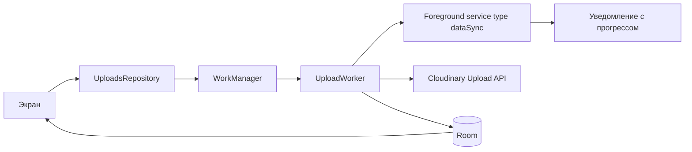

# ТЗ: загрузка видео на Cloudinary

Android-only многомодульное приложение. Пользователь выбирает свои ролики и заливает их на Cloudinary. Цель пета — руками собрать Dagger 2 (без Hilt) и провести загрузку через весь фон: очередь, переживание смерти процесса, прогресс в уведомлении и на экране.

Секрета Cloudinary в приложении нет. В `local.properties` только `cloud_name` и **unsigned upload preset**. Подпись запросов (`api_secret`) не делаем.

## Экраны

- **Библиотека** — уже залитые ролики: превью с Cloudinary, название, длительность. Пустое состояние с кнопкой «Выбрать видео».
- **Детали** — превью, `public_id`, статус. Играть по `secure_url`, удалить запись из библиотеки приложения.
- **Загрузки** — очередь: прогресс в байтах и процентах, пауза, продолжение, отмена, повтор после ошибки.
- **Настройки** — только по Wi‑Fi, число одновременных загрузок (1–3).

Нижняя навигация: Библиотека и Загрузки. Выбор файла — системный Photo Picker (`video/*`), можно несколько за раз. Настройки — иконка на экране загрузок. Детали — отдельный экран.

## Функционал

- Поставить выбранные ролики в очередь. Повторный выбор того же файла не создает вторую активную задачу.
- Лить на Cloudinary в фоне. Прогресс виден в уведомлении и в списке загрузок, пока приложение свернуто.
- Большие файлы — chunked upload: чанк от 5 МБ, заголовок `X-Unique-Upload-Id`, `Content-Range`. В Room хранится id сессии и сколько байт уже принято, чтобы повтор и «продолжить» шли не с нуля.
- Пауза останавливает работу и сохраняет offset. Отмена бросает сессию и чистит локальную задачу. Исходный файл в галерее не трогаем.
- Успех: в Room пишутся `public_id`, `secure_url`, длительность. Ролик появляется в библиотеке.
- «Только Wi‑Fi» применяется к новым и уже стоящим в очереди задачам.
- Ошибки сети: backoff у WorkManager, на экране статус «ошибка» и «повторить».

Эндпоинт: `POST https://api.cloudinary.com/v1_1/{cloud_name}/video/upload` с `upload_preset` и `resource_type=video`.

## Как устроен фон

- **WorkManager** — очередь, ограничения сети, backoff, уникальная работа на один файл (`UniqueWork` по id задачи).
- **Foreground service** (`dataSync`) поднимается из воркера на время активной передачи. Уведомление с прогрессом, паузой и отменой через actions.
- **Room** — источник правды для UI: статус, offset, `public_id`, `secure_url`. UI подписан на `Flow`.

## Модули

- `:app` — `Application`, корневой `AppComponent`, навигация, тема, чтение `cloud_name` и preset из BuildConfig.
- `:core:common` — модели, диспетчеры, ошибки.
- `:core:network` — OkHttp, chunked upload, прогресс по байтам.
- `:core:database` — Room: задачи загрузки и залитые ролики.
- `:core:upload` — WorkManager, foreground service, уведомления, репозиторий, клиент Cloudinary.
- `:feature:library` — библиотека и детали.
- `:feature:uploads` — очередь, выбор видео, настройки.

Фичи не зависят друг от друга. Общее вынесено в `core`.

## MVI

Свой тонкий MVI на каждый экран, без Orbit и MVIKotlin. Поток один: UI шлет `Intent`, `ViewModel` вызывает use case, чистое состояние рисует экран.

На экран три типа:

- `State` — immutable `data class`, один `StateFlow`. Список, пусто, ошибка и прогресс живут здесь.
- `Intent` — `sealed interface`. Экран вызывает только `onIntent`. Кнопки, пауза, отмена, смена настроек — отдельные интенты.
- `Effect` — `sealed interface` и `SharedFlow`. Одноразовое: открыть пикер, перейти на детали, снекбар, запустить плеер. В `State` это не кладем, чтобы поворот экрана не повторял навигацию.

`ViewModel` не отдает наружу мутабельное состояние. Сообщения из use case и из интента сводятся чистой функцией `reduce(state, message) -> state`. Подписка на Room (`Flow`) тоже приходит как сообщение, не как прямая запись полей.

Экраны:

- **Библиотека** — состояние: загрузка / пусто / список. Интенты: выбрать видео, открыть, удалить. Эффекты: пикер, навигация на детали.
- **Детали** — состояние ролика. Интенты: играть, удалить. Эффект: открыть плеер.
- **Загрузки** — очередь и статусы. Интенты: пауза, продолжить, отмена, повтор. Эффект: снекбар об ошибке.
- **Настройки** — Wi‑Fi и лимит параллелизма. Интенты меняют состояние, эффект не нужен.

Общий контракт (`StateFlow`, `SharedFlow`, `onIntent`) лежит в `:core:common`. Сами `State` / `Intent` / `reduce` остаются в модуле фичи.

## Стек

- Kotlin, minSdk 26, Jetpack Compose, Navigation, ViewModel, Coroutines, Flow
- **Dagger 2 вручную**, без Hilt и без KSP-плагина Hilt
- Room, WorkManager, OkHttp
- Photo Picker, Media3 ExoPlayer для просмотра `secure_url`
- DataStore для настроек
- Coil для превью Cloudinary

Архитектура внутри фичи: `Intent -> ViewModel -> UseCase -> Repository`, назад `State` и `Effect`. Репозитории и воркеры живут в `core`.

## Что именно прокачивает Dagger

Сборка ближе к «голому» Dagger, чем к Hilt:

- Корневой `@Singleton @Component` в `:app`, модули с `@Provides` / `@Binds`.
- Отдельные компоненты фич через **component dependencies** (не `@AndroidEntryPoint`): экран получает фабрику из `Application`.
- Кастомный `@UploadScope` на граф загрузки.
- `@Qualifier` для обычного OkHttp и для upload-клиента с длинными таймаутами.
- `CloudinaryConfig` приходит из графа, значения — из BuildConfig, не из кода фичи.
- `WorkerFactory` + **assisted injection** для `UploadWorker` (id задачи приходит из `inputData`).
- Multibinding фабрик ViewModel — один способ на весь проект, без `HiltViewModel`.
